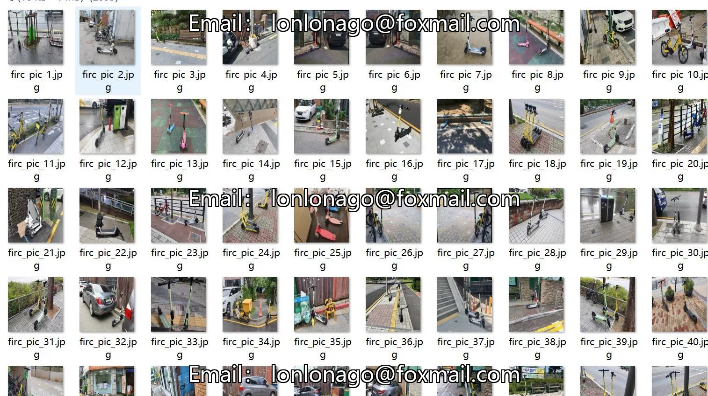
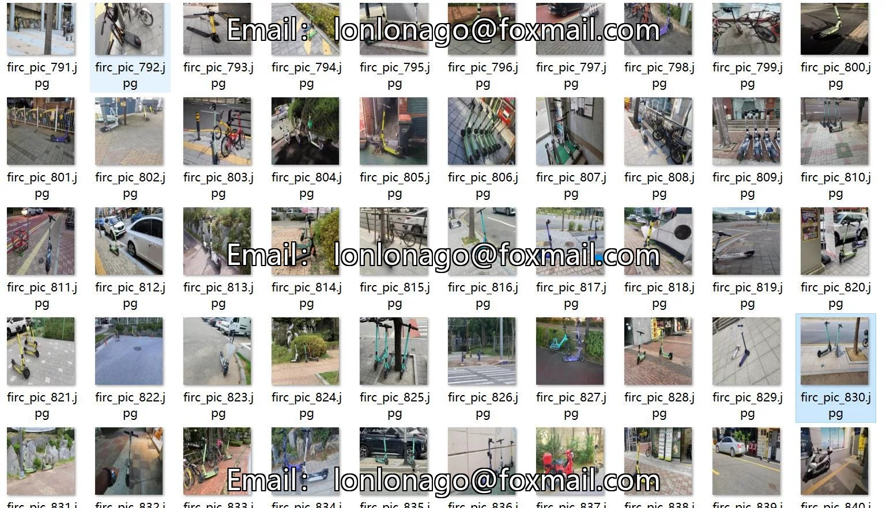
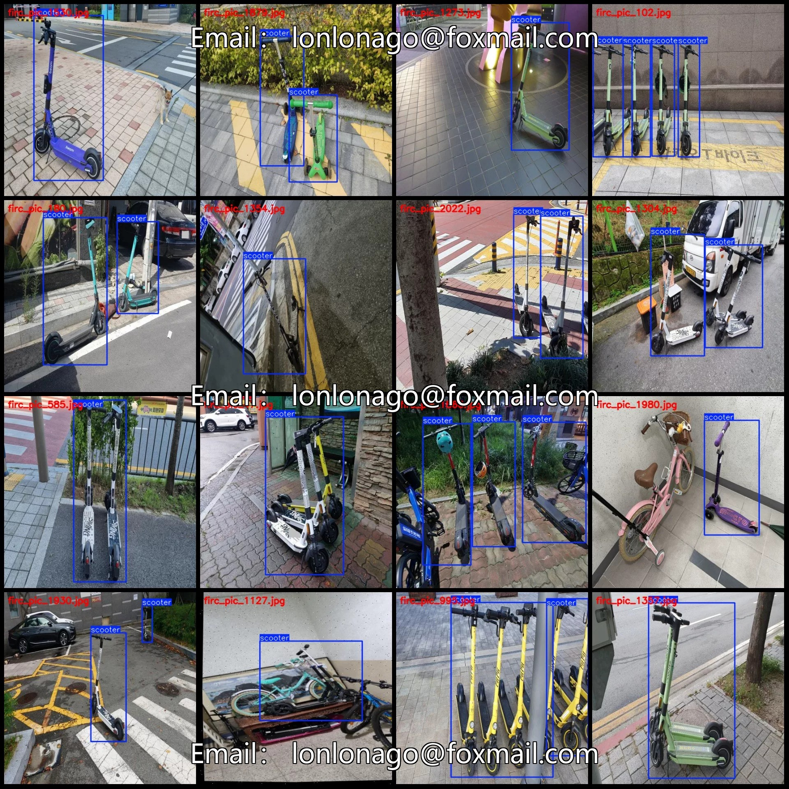
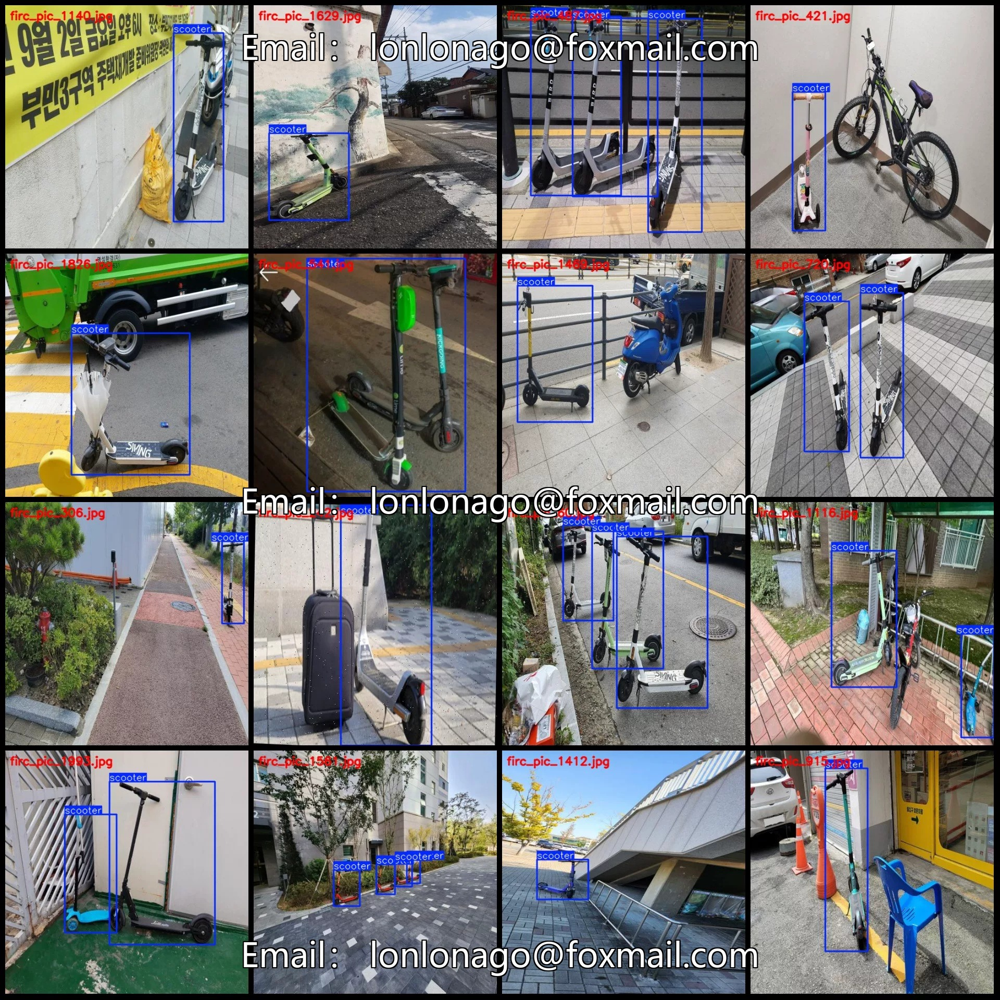
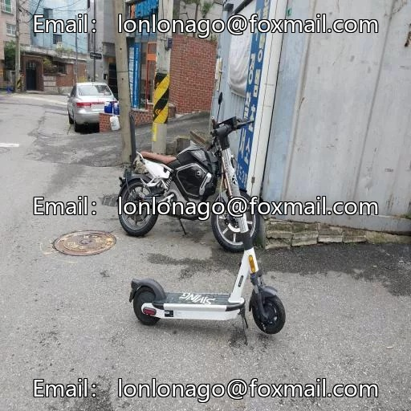
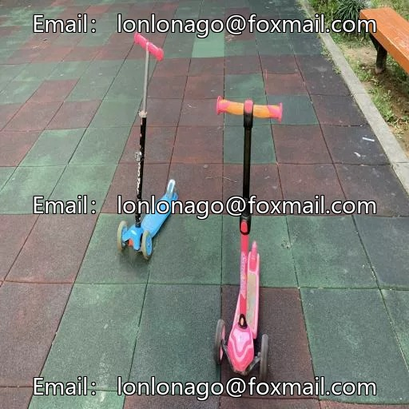
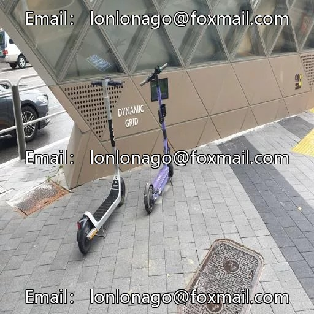

# City Street Skateboard Detection Dataset VOC+YOLO format with 2055 images in 1 category

## Body

City Street Skateboard Detection Dataset VOC+YOLO format with 2055 images in 1 category
Warm reminder: Due to the dataset's replicability, please confirm compliance before purchasing.
Dataset format: Pascal VOC format + YOLO format (txt file without split path, only contains jpg images and corresponding VOC format xml files and yolo format txt files)
Number of images (number of jpg files): 2055
Number of annotations (number of xml files): 2055
Number of annotations (number of txt files): 2055
Label category count: 1
Category Name: ["scooter"]
Number of boxes and the number of images occupied by each category

Number of scooter frames = 3015, number of images occupied = 2055
Total frame count: 3015
Image resolution: 512x512
Labeling tool used: labelImg
Labeling rules: Draw a rectangle around the category.
Important note: The dataset does not include splits for training, validation, or testing; you need to manually divide it.
Special declaration: This dataset does not guarantee the accuracy of the trained models or weight files.

## Images

## Payment

Here is a pay link on Stripe ( https://buy.stripe.com/3cs8yP7sY87d0vu9AB ). Please contact me lonlonago@foxmail.com after funding $89, and I will send you a complete data files , thank you!

